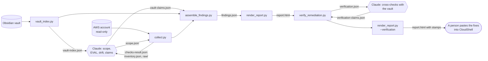

# infra-compliance-audit

Claude Code skill `auditing-infra-compliance`: it pre-audits AWS infrastructure against SOC 2 (TSC 2017) and ISO/IEC
27001:2022 and delivers **one self-contained HTML** that says whether the infrastructure is optimal, with findings,
mappings to Drata and Vanta tests and CloudShell commands that a person copies and pastes. It is meant for
engineering, DevOps and security teams preparing for an audit (or wanting to know whether the platform will pass
Drata's or Vanta's automated tests) and for whoever maintains an Obsidian vault with the infrastructure documentation.

**Absolute rule: the skill only reports.** It produces a report and remediation commands for a human; it **never
writes to AWS and never applies a fix** (neither Claude nor the scripts), even if asked, "just to test", with another
tool or with a write profile. It does not offer access, PRs or IaC to apply it. A person pastes the commands
into CloudShell, after reading them.

**Flexible source: it verifies whatever it is given.** It evaluates with read-only AWS credentials, with an Obsidian
vault (typed or free-form) or with both. The verdict (`OPTIMAL` / `NOT_OPTIMAL` / `NOT_VERIFIABLE`) **always says what
it is based on** (`summary.verdict_basis`: `aws`, `vault` or `aws+vault`). A verdict based only on the vault never says
AWS verified anything.

**Language.** The skill talks to the user in the user's language (English or Spanish requests both trigger it); the
report and all files it produces are English.

## Contents

1. [What it does and what it does not do](#what-it-does)
2. [How it works](#how-it-works)
3. [Sources and verdict](#sources-and-verdict)
4. [Modes of use](#modes-of-use)
5. [Requirements](#requirements)
6. [Installation](#installation)
7. [Recommended AWS permissions](#recommended-aws-permissions)
8. [Step-by-step usage and generated files](#step-by-step-usage-and-generated-files)
9. [How to read the report](#how-to-read-the-report)
10. [Fix verification stage](#fix-verification-stage)
11. [Coverage](#coverage)
12. [Security and privacy](#security-and-privacy)
13. [Drata and Vanta connected through MCP (phase 2)](#drata-and-vanta-connected-through-mcp-phase-2)
14. [Known limitations](#known-limitations)
15. [Repository structure](#repository-structure)
16. [Development](#development)
17. [Documentation](#documentation)

## What it does

- Reads an Obsidian vault (typed or free-form) to learn what should exist and what it is for.
- Verifies the AWS account with **read-only** credentials: an inventory (33 resource types) plus a catalog of 98
  checks in eleven domains (IAM, logging, detection, encryption, network, compute, data, monitoring, inventory,
  integration and email; the detail is in [Coverage](#coverage) and in `validate_catalog.py --list`).
- Compares what is documented with what is deployed and reports it as `DRIFT`, `UNDOCUMENTED`, `DOCUMENTED_ONLY` or
  `DOCUMENTED_GAP`.
- Computes a **verdict** with whatever source it is given and says what it is based on (see [Sources and verdict](#sources-and-verdict)).
  There is no percentage or grade.
- Maps each finding to SOC 2 criteria, ISO 27001:2022 Annex A controls, Drata tests and Vanta tests, and marks as
  "inferred" any mapping that has no source.
- Builds the remediation commands for CloudShell and **verifies them without executing them** (syntax, pending values,
  conflicts between fixes, tests that depend on the resource); it suggests an order of application.
- Produces `report.html`, `findings.json`, `checks-result.json`, `inventory.json` and `raw/` in
  `./compliance-reports/<platform>-<scope>-<date>/`, always outside the vault.
- Shows the collection progress and leaves a usable partial result if the run is cut short.
- The scripts decide PASS/FAIL and build the commands, the mappings and the HTML; Claude reads the vault, resolves the
  scope and judges only what the scripts cannot decide.

## What it does not do

- **It never writes to AWS.** `aws_runner.py` only admits `describe-*`, `list-*` and `get-*` (plus `lookup-events`,
  `generate-credential-report` and the narrow exception `inspector2 batch-get-account-status`), rejects a denylist of
  reads that expose secrets and operations with a sensitive name (credential, password, token, secret…) except for
  reviewed exceptions, and rejects every `https://` or `http://` argument (the CLI would try to download it). It also only
  runs the (service, operation) pairs of `catalog.REVIEWED_OPERATIONS`: adding a call requires adding it there and
  `validate_catalog.py` fails if it is missing.
- **It does not apply fixes, not even if asked or "just to test":** a person pastes the commands into
  CloudShell. Nor does it offer write access, PRs or IaC. Fixes that replace a policy or configuration
  read the current one first and stop (`STOPPED`) if they cannot read it; none is executed from the skill.
- It is not an audit opinion nor a score: there is no compliance percentage or grade, only counts by status and
  severity, and the verdict with its basis.
- It does not evaluate organizational controls (policies, risk analysis, training, HR, vendors, ISMS
  management): it lists them as "outside the scope of this report" so nobody reads "all green" as "ready for SOC 2".
- It does not read `.env*`, `~/.aws/credentials`, `*.pem` or `*.key` files; it detects them by name only. Detection of
  secrets inside notes has known limits (see [Limitations](#known-limitations)).
- It does not write to the vault, nor leave the report inside it.
- It does not invent Drata or Vanta test names nor SOC 2 or ISO IDs: it uses only what comes from the catalog and from
  `references/mappings/`.
- It does not cover Windows (Linux and macOS), other clouds, several accounts in one run or code or IaC repositories, and does not
  query Drata or Vanta live unless an MCP is connected (see [Phase 2](#drata-and-vanta-connected-through-mcp-phase-2)).

## How it works

The skill is a pipeline of five command-line scripts. Claude orchestrates them and does only the work that requires
reading and judgment; it does not write HTML, `aws` commands or test names by hand.



| Stage | Script | What it does | Who decides |
|---|---|---|---|
| 1 | `vault_index.py index` / `feature` | Indexes the vault (`.md` only, masked) and resolves a feature's components | Script |
| 2 | (scope) | Writes `scope.json`: mode, regions, resources, domains | Claude |
| 3 | `collect.py` | Inventory and read checks against AWS; PASS/FAIL, `NOT_VERIFIED` with the missing permission | Script |
| 4 | (claims) | Resolves the `PENDING_CLAUDE` rows, compares the vault with reality (drift) and writes `vault-claims.json` | Claude |
| 5 | `assemble_findings.py` | Joins everything into `findings.json`: placeholders, mappings, severities, coverage, verdict | Script |
| 6 | `render_report.py` | Generates `report.html` (fixed template, no external resources) | Script |
| 7 | `verify_remediation.py` | Verifies the remediation commands without executing them and orders their application | Script |
| 8 | (review) | Cross-checks the risky fixes with the vault and writes `verification-claims.json` | Claude |
| 9 | `verify_remediation.py --claims` + `render_report.py --verification` | Final verification and HTML with stamps | Script |

Of the 98 catalog checks, only one (IAM-013, "custom policies with broad wildcards") is judged by Claude
(`PENDING_CLAUDE`); the rest are evaluated by the scripts (a JMESPath expression that the AWS CLI itself runs with `--query`,
Python evaluators or DNS queries). Claude does not re-evaluate a script's PASS or FAIL.

## Sources and verdict

**At least one source** is needed: a vault, read-only AWS credentials, or both.

| Sources | What is evaluated | `verdict_basis` |
|---|---|---|
| AWS credentials only | What is real: the discovered inventory and the catalog of checks | `aws` |
| Vault only | What is documented: nothing is marked `PASS` or `FAIL`; the findings are `DOCUMENTED_*` | `vault` |
| Credentials and vault | What is real, plus the differences between what is documented and what is deployed (drift) | `aws+vault` |
| None | There is no report: `assemble_findings.py` ends with exit `2` ("no sources") | |

The verdict is in `summary.verdict` (`OPTIMAL`, `NOT_OPTIMAL` or `NOT_VERIFIABLE`), with its sentence in
`summary.verdict_text` and its reasons in `summary.verdict_reasons`; it is the first thing the HTML shows, next to the basis.
The order of severity is `NOT_OPTIMAL` > `NOT_VERIFIABLE` > `OPTIMAL`.

**With credentials (basis `aws` or `aws+vault`):**

| Verdict | When |
|---|---|
| `NOT_OPTIMAL` | Any `FAIL`; a `DRIFT` or `UNDOCUMENTED` with `actual_status: FAIL` (reality violates it); or a critical or high `DOCUMENTED_GAP` |
| `NOT_VERIFIABLE` | Partial run, regions blocked by SCP, incomplete inventory, anything `NOT_VERIFIED` or only documented, scope components not verified, or no evaluated `PASS` or `FAIL` |
| `OPTIMAL` | Complete run, nothing unverified and at least one evaluated `PASS` or `FAIL` |

**With the vault only (basis `vault`):**

| Verdict | When |
|---|---|
| `NOT_OPTIMAL` | A critical or high `DOCUMENTED_GAP`, a detected secret or sensitive file, or a claim with `actual_status: FAIL` |
| `OPTIMAL` | At least one documented control in scope, no documented gap and nothing in scope left undocumented; it is still "not verified against AWS" |
| `NOT_VERIFIABLE` | Everything else; `verdict_reasons` says which components or controls the vault does not document |

Examples of `verdict_text`: "Optimal based on what the vault documents (not verified against AWS)", "Not optimal based on AWS:
…", "Optimal based on AWS and the vault".

**Drift (`DRIFT`).** With both sources, reality rules: what the vault claims is compared with `inventory.json` and
`checks-result.json`. If the vault says one thing and the account another, the finding is `DRIFT` and both versions are shown;
only with `actual_status: FAIL` (reality violates the check) does it keep the complete fix. A live resource the vault
does not mention is `UNDOCUMENTED` (severity `low` by default; ISO 5.9 asks for an asset inventory). A vault `status`
of `proposed`, `todo` or `draft` means "does not exist": it is reported as `DOCUMENTED_GAP` and never as a control in force.

**Without credentials:** the report states in the header that nothing was verified against AWS, shows the counts of what is
documented and what is unverified instead of zeros that would read as "clean", and lists the scope components "not
verified".

If `scope.json` is malformed (not an object, unknown mode or domain, empty or malformed `resources`) or carries an invalid
`scope.regions`, `collect.py` ends with exit `2` and a message, without writing files. A well-formed scope whose resources
have no catalog check (for example an SNS topic or a subnet) runs normally: it warns "no catalog check applies to: …" and
those components are listed as not verified. If the regions cannot be listed
(`ec2:DescribeRegions`) in `auto` mode, account checks with regional calls stay `NOT_VERIFIED`, never
`PASS` for looking only at `us-east-1`.

## Modes of use

The skill is **never invoked automatically**: you run it with `/auditing-infra-compliance <request>`, and the request can
be written in **English or Spanish** (for example `/auditing-infra-compliance audit the whole account` or
`/auditing-infra-compliance revisá el envío de email`). Claude answers in your language; the report is English. The scope
is deduced from what is asked. Missing
inputs are asked for in **a single message**: scope, platform name, vault path ("there is no vault" is a valid answer),
extra evidence folder (optional), AWS profile (optional if there is a vault), regions
(optional) and tool (`--tool drata|vanta|both`, optional).

| Mode | What for | Example request |
|---|---|---|
| `full` | The whole account | "Audit the Acme Notes infrastructure for SOC 2. The vault is at `~/vaults/acme-notes` and I use the `acme-audit` profile." (Spanish works too: "Auditá la infraestructura de Acme Notes para SOC 2.") |
| `feature` | One flow or functionality | "Review the Acme Notes email sending against SOC 2." (Spanish: "Revisá el envío de email de Acme Notes contra SOC 2.") |
| `resource` | One resource by ID or ARN | "Does the `acme-notes-uploads` bucket pass the Drata tests?" or "Review `sg-0a1b2c3d4e5f60718` against compliance." |

**`feature` mode.** With "review the email sending", the skill looks for the note in the vault (`vault_index.py feature`),
resolves its components and **shows them before collecting**, marking the inferred ones and the pending ones (`proposed`), and
**waits for your confirmation**. Example of what it shows:

```
Feature "email sending" → note systems/Email delivery.md (typed vault)
  1. SES Identity        ses_identity    shipped    example.com
  2. Mailer Lambda       lambda_function shipped    acme-notes-mailer
  3. Mail Queue          sqs_queue       shipped    acme-notes-mail-queue
  4. DMARC reject policy (no resource)   proposed   PENDING: does not exist yet
Do you confirm this list, or should I add/remove something?
```

`proposed`, `todo` or `draft` components are not audited as live resources: they come out as `DOCUMENTED_GAP`. The security
groups, VPCs, subnets and roles that surround the feature are also listed separately, as "context", so you
confirm whether they enter the scope. If the feature is not documented and there are credentials, it offers to look for it in the inventory
(by tags and name) and marks everything found as **inferred**. With a free-form vault it warns that the feature map is
inferred and less reliable.

**`resource` mode.** The type comes from the prefix (`i-…`, `sg-…`, `db-…`) or the ARN; the resource and its immediate context are audited
(for an EC2 instance: security groups, volumes, instance profile, subnet, VPC Flow Logs). Without
credentials only what the vault says about that ID is reported, and the skill says so up front. A request with an ID and no
vault or credentials does not go forward: it asks for a source.

## Requirements

| Requirement | Detail |
|---|---|
| Python 3.10 or higher | Standard library only, no `pip install` |
| AWS CLI v2 | With a read-only profile (or the already configured environment) |
| bash | For `verify_remediation.py` (`bash -n` on the remediation commands, without executing them) |
| `dig` or `nslookup` | Optional: DNS checks (SES SPF and DMARC). With neither, those checks stay `NOT_VERIFIED` |
| `node` and `jq` | Optional, only for some tests (see [Development](#development)); the skill does not need them |
| AWS CloudShell | Where a person pastes the fixes, after reading them |
| Linux or macOS | Windows is out |

## Installation

Clone the repo and link the skill folder into Claude Code's skills folder:

```bash
git clone <repo-url>
cd <repo-folder>
mkdir -p ~/.claude/skills
ln -s "$PWD/auditing-infra-compliance" ~/.claude/skills/auditing-infra-compliance
```

The skill is available in the next Claude Code session as `/auditing-infra-compliance` (it is user-invoked only:
`disable-model-invocation: true`, so Claude never loads it on its own). The scripts need no installation.

## Recommended AWS permissions

Use a dedicated, read-only role or user with the AWS-managed policies **`SecurityAudit`** and
**`ViewOnlyAccess`**. If they are missing, also add a policy with these actions (used by the backup and
Inspector checks):

```json
{
  "Version": "2012-10-17",
  "Statement": [
    {
      "Effect": "Allow",
      "Action": [
        "backup:ListBackupJobs",
        "inspector2:BatchGetAccountStatus",
        "inspector2:ListFindings"
      ],
      "Resource": "*"
    }
  ]
}
```

- Do not use an identity with `AdministratorAccess`: the skill warns with a `WARNING` line (it only detects the
  `AdministratorAccess` managed policy attached to the identity) and suggests a `SecurityAudit` + `ViewOnlyAccess` role, but does not
  block.
- If someone offers an admin profile, Claude may only use it for the read-only collection the
  scripts allow, and never to apply a fix.
- Never paste keys in the chat; give only the profile name (`AWS_PROFILE` or the `profile` field of
  `scope.json`).
- If a permission is missing, the corresponding check stays `NOT_VERIFIED` and says which one. If an SCP denies the read,
  the row says "blocked by SCP" and no permission is requested (it is not a permission missing from the profile).
- If the profile has already expired (`ExpiredToken`, `InvalidClientTokenId`), renew it (for example `aws sso login --profile
  <profile>`); the skill never asks for pasted keys.

## Step-by-step usage and generated files

Normally you ask Claude (see [Modes of use](#modes-of-use)); it runs the pipeline. To repeat it by hand, or to
understand what it does at each step:

```bash
SKILL_DIR="/absolute/path/to/auditing-infra-compliance"
RUN="/absolute/path/compliance-reports/acme-notes-full-2026-11-12-1030"
mkdir -p "$RUN"

# 1. Vault index (optional; nothing is written inside the vault)
python3 "$SKILL_DIR/scripts/vault_index.py" index "<vault>" -o "$RUN/vault-index.json"
# feature mode only: resolve a feature's components (JSON on stdout)
python3 "$SKILL_DIR/scripts/vault_index.py" feature "$RUN/vault-index.json" "email sending"

# 2. Write $RUN/scope.json (see the example below)

# 3. Collect (read-only); --quiet turns off the progress on stderr
python3 "$SKILL_DIR/scripts/collect.py" --scope "$RUN/scope.json" --out "$RUN" [--quiet]

# 4. (Claude) write $RUN/vault-claims.json

# 5. Assemble findings.json
python3 "$SKILL_DIR/scripts/assemble_findings.py" --run-dir "$RUN" \
  [--vault-index "$RUN/vault-index.json"] [--vault-claims "$RUN/vault-claims.json"] \
  --platform "Acme Notes" --mode full [--target "<text or id>"] [--tool drata|vanta|both]

# 6. First render
python3 "$SKILL_DIR/scripts/render_report.py" "$RUN/findings.json"

# 7. Verify the fixes (--check-cli only if there is a local AWS CLI)
python3 "$SKILL_DIR/scripts/verify_remediation.py" --run-dir "$RUN" [--check-cli]

# 8. (Claude) write $RUN/verification-claims.json only if there is something to review; then:
python3 "$SKILL_DIR/scripts/verify_remediation.py" --run-dir "$RUN" --claims "$RUN/verification-claims.json" [--check-cli]
python3 "$SKILL_DIR/scripts/render_report.py" "$RUN/findings.json" --verification "$RUN/verification.json"
```

Example `scope.json` (`feature` mode):

```json
{"platform": "Acme Notes", "mode": "feature", "target": "email sending",
 "regions": "auto", "profile": null,
 "resources": [
   {"type": "ses_identity", "id": "example.com", "region": "us-east-1"},
   {"type": "lambda_function", "id": "acme-notes-mailer", "region": "us-east-1"}
 ],
 "domains": null}
```

| Field | Value |
|---|---|
| `platform` | Readable name (for the report and the folder) |
| `mode` | `full`, `feature` or `resource` |
| `target` | `null` in `full`; the feature text or the resource id/ARN |
| `regions` | `"auto"` (enabled regions with resources, plus `us-east-1`) or a **non-empty** list of regions, e.g. `["us-east-1", "eu-west-1"]`. A region that is not enabled is skipped with a warning |
| `profile` | AWS profile name or `null` for the already configured environment. Never a key |
| `resources` | `[]` in `full`; in `feature` and `resource`, `{type, id, region}` objects with `type` from `references/inventory.json` |
| `domains` | `null` (all) or a list to narrow: `compute`, `data`, `detection`, `email`, `encryption`, `iam`, `integration`, `inventory`, `logging`, `monitoring`, `network` |

`scope.json` is saved in the run folder and is neither moved nor deleted before assembling:
`assemble_findings.py` reads it from there to list the "unverified" components.

### Regions

`scope.regions` decides where to collect. In `auto` mode the enabled regions with resources plus
`us-east-1` are inventoried; the "all regions" checks (GuardDuty, Config, Access Analyzer, CloudTrail…) walk the
enabled regions. In accounts with many regions it pays to narrow the list to shorten the run. Regions
that an SCP blocks are dropped with a warning, reported as not verified (never as compliant) and kept in
`aws.blocked_regions`.

### Run folder

`./compliance-reports/<platform>-<scope>-<YYYY-MM-DD-HHMM>/` in the working directory, never inside the vault
(the repo ignores `compliance-reports/`). Examples: `acme-notes-full-2026-11-12-1030`,
`acme-notes-feature-email-2026-11-12-1030`.

| File | Written by | Content |
|---|---|---|
| `scope.json` | Claude | Resolved scope (mode, regions, resources, domains) |
| `vault-index.json` | `vault_index.py index` | Notes, edges, AWS IDs, broken links, `secrets_detected` (pattern, never the value) and `sensitive_files` (name only) |
| `inventory.json` | `collect.py` | Normalized inventory of the account (empty without credentials) |
| `raw/<CHECK_ID>/` | `collect.py` | Raw output of each call (masked), with the `argv` executed |
| `checks-result.json` | `collect.py` | One row per check and resource (`PASS`, `FAIL`, `N/A`, `NOT_VERIFIED`, `PENDING_CLAUDE`), warnings and, if the run was cut short, `partial` and `pending_checks` |
| `vault-claims.json` | Claude | `EVAL`, `DRIFT`, `UNDOCUMENTED`, `DOCUMENTED_ONLY` and `DOCUMENTED_GAP` claims |
| `findings.json` | `assemble_findings.py` | `meta`, `summary` (verdict), `findings`, `dependencies`, `coverage`, `warnings`, `notes` |
| `verification-claims.json` | Claude | Review of fixes against the vault (only if there is something to review) |
| `verification.json` | `verify_remediation.py` | Stamp per fix, conflicts, gaps, `apply_order` |
| `report.html` | `render_report.py` | The report: a single file, inline CSS and JS, no external resources |

Claude writes only three files (`scope.json`, `vault-claims.json`, `verification-claims.json`). Everything else is
generated by the scripts and is not edited by hand: if a report field is wrong, the claim is fixed and it is
assembled again. Everything that is written is masked (see [Security and privacy](#security-and-privacy)).

### Exit codes

| Script | `0` | `2` | Others |
|---|---|---|---|
| `vault_index.py` | Index or feature resolved | Invalid vault, or `-o` inside the vault | |
| `collect.py` | Complete run (also a well-formed scope that no check covers: no results and with a warning) | No valid credentials (leaves `checks-result.json` with `aws: null` and an empty `inventory.json`) or a malformed `scope.json` (message, no files) | `130`: interrupted (Ctrl-C, SIGTERM, timeout); leaves the partial result |
| `assemble_findings.py` | `findings.json` written | Input file with an invalid shape, or "no sources: a vault or read-only AWS credentials are required" (does not write `findings.json`) | |
| `render_report.py` | `report.html` written | `findings.json` is missing or invalid JSON | |
| `verify_remediation.py` | `verification.json` written (even with a `CONFLICT`: it is a result, not an error) | The folder or `findings.json` is missing, or invalid JSON | |
| `validate_catalog.py` | Valid catalog | | `1`: problems in the catalog |

### Long runs

In `full` mode or on a large account the collection takes minutes:

- **Progress:** `collect.py` prints to stderr one line per finished check (`[done/total] CHECK-ID`) and one for the
  inventory; `--quiet` turns them off. The final summary (at most about 40 lines, with the first five `WARNING`s) goes to
  stdout; the detail is in `checks-result.json`, `inventory.json` and `raw/`, and the full warnings in
  `warnings` of `checks-result.json`.
- **Partial result:** `inventory.json` is written as soon as the inventory finishes and `checks-result.json` is
  updated about every 15 seconds with `"partial": true` and `pending_checks`. An interrupted run (exit `130`) leaves the
  partial file; `assemble_findings.py` declares it in a warning ("PARTIAL result…") and the verdict is never
  `OPTIMAL`. There is no option to run only the pending ones: run it again, narrowing `domains` or `regions` in a
  new folder if needed.
- **Background:** it is best to run it in the background (or with a generous timeout) and read only the summary when it finishes.
- Identical calls are reused and the failure of one region or item does not take down the whole check: that region ends up
  `NOT_VERIFIED` and the healthy ones keep their result.

## How to read the report

Open `report.html` in the browser (it works offline and can be attached as evidence). From top to bottom:

1. **Verdict and basis.** `Optimal`, `Not optimal` or `Not verifiable`, with the source it rests on. Without credentials
   there is an explicit notice that nothing was verified against AWS.
2. **Summary.** Counts by status and by severity (of the failures), failing Drata and Vanta tests, list of what is not
   verified and missing permissions. Clicking a count filters the findings. No percentages.
3. **Fix verification** (if `verify_remediation.py` was run): conflicts, gaps, order of application and
   number of values to fill in.
4. **Filters.** Severity, status, domain, tool (Drata or Vanta), standard (SOC 2 or ISO 27001) and a text
   search; "Expand all" and "Collapse all". If `--tool` was passed, the tool filter comes preselected (both
   remain available). Filters are remembered in the browser.
5. **Copy low-risk fixes** (see below).
6. **Finding cards**, ordered by severity: resource and region, status, severity, mapping chips, evidence, what the
   vault claims, remediation and verification stamp.
7. **Do not touch without review.** Resources that currently passing tests depend on (turning off Multi-AZ, deleting Flow Logs or the
   CloudTrail access-logs bucket would turn them red). A vault recommendation like that is reported as `DRIFT`
   `high` with "this vault recommendation would break <test>".
8. **Standards coverage, run warnings** (broken vault links, missing permissions, skipped regions,
   free-form vault, partial result) and the footer: "Automated technical pre-audit. It is not an audit opinion and does not
   cover organizational controls (policies, HR, teams, vendors, ISMS)."

It has light and dark modes and clean printing.

### Statuses

| Status | Meaning | Does it carry fix commands? |
|---|---|---|
| `FAIL` | Verified in AWS: does not comply | Yes, complete |
| `PASS` | Verified in AWS: complies | No: only "Verify with" |
| `DRIFT` | The vault claims something different from reality (both versions are shown) | Only if reality violates (`actual_status: FAIL`) |
| `DOCUMENTED_ONLY` | Vault only: says it complies, not verified (severity `low`; the check's own stays in the evidence as "not verified") | No |
| `DOCUMENTED_GAP` | Vault only: says it is missing or `proposed` ("documented as pending") | Yes, complete |
| `UNDOCUMENTED` | Exists in the account and the vault does not mention it (severity `low` by default) | Only if reality violates (`actual_status: FAIL`) |
| `NOT_VERIFIED` | Could not be checked: a permission is missing (it says which), "could not list the regions", "incomplete inventory", "blocked by SCP", no credentials | No |
| `N/A` | Does not apply; with `vacuous` it is a "vacuous pass" (there are no resources of that type). **Never `PASS`** | No |

Without a fix, the card shows "Verify with" (the read-only command to check it) and the note "not verified:
do not apply without confirming". A finding evaluated by Claude is marked "evaluated by Claude"; one transcribed from the vault, "transcribed
from the vault, not verified".

### Severities

| Severity | When |
|---|---|
| `critical` | Public exposure of data or credentials; root without MFA or with access keys; secrets or sensitive files next to the vault |
| `high` | A Drata or Vanta automated test fails |
| `medium` | A Security Hub, CIS or FSBP control fails with no direct Drata or Vanta test |
| `low` | Hygiene |

### Remediation types (`remediation.kind`)

| `kind` | What it is |
|---|---|
| `cli` | One or a few commands that fix the problem with no decisions from the user |
| `cli_with_decision` | There is a value a person decides (retention days, owner email, CIDR, a key's ARN) or the command replaces an existing configuration or policy: it carries a prior read-only block and/or `__FILL_IN_…__` |
| `planned_change` | Multi-step, destructive or with downtime (encrypting an existing RDS, migrating a key): numbered steps, warning, risk and downtime. It is never "one command" |
| `console_only` | Cannot be done by CLI (root MFA): steps in plain language, no commands |

Each fix also declares `risk` (`low`, `medium`, `high`), `downtime` and a "verify afterwards" command. Commands
start with the block's variables (`REGION=…`, `ACCOUNT_ID=…`) and never use `set -e`.

### Values to fill in (`__FILL_IN_…__`)

A value the skill cannot know, or that is not safe to inject into a command (it carries quotes, spaces, `$`), stays
as `__FILL_IN_<NAME>__` (for example `__FILL_IN_OWNER_EMAIL__`, `__FILL_IN_KMS_KEY_ARN__`,
`__FILL_IN_REGION__`). The HTML highlights and counts them. **They must be filled in before pasting**; the skill never
replaces them with a plausible value. The format is not `<<…>>` because in bash `<<` opens a heredoc.

### Copy buttons

- **Copy** (per block): copies a CloudShell command or the "verify afterwards" command.
- **Copy all**: appears only on `cli` fixes with more than one block. `cli_with_decision` and
  `planned_change` fixes are copied and applied block by block, reading each one.
- **Copy low-risk fixes** (per severity): gathers only low-risk `cli` fixes, with no pending
  values, that the verification stamped `OK`. It excludes `REVIEW`, `CONFLICT` and those with no stamp. Without a
  current verification (never run or stale) the button is disabled and says why. The commands still have to be read
  before pasting.

### Coverage tables and organizational controls

The "Standards coverage" section has a table for ISO 27001:2022 (Annex A) and another for SOC 2 (TSC 2017). Each
control touched by the checks is listed as `FAIL`, `NOT_VERIFIED`, `PASS` or `NOT_TOUCHED`. A control touched
only by `DOCUMENTED_ONLY` or `DOCUMENTED_GAP` findings is listed `NOT_VERIFIED` (the vault says so, nobody checked). Controls
are grouped into technical, inherited from AWS and **organizational: "outside the scope of this report"**; the
organizational ones that a finding touches are listed separately as "mentioned by findings", with the status that comes from the
finding (the report does not evaluate them). It is not a global compliance indicator.

## Fix verification stage

After the first render, `verify_remediation.py` reviews the remediation commands **without executing anything in AWS**:
it only runs `bash -n` and, with `--check-cli`, `aws <service> <operation> help` (local help, no traffic to AWS; each
`--flag` of the command must appear in the help). It writes `verification.json` and gives each fix a stamp:

| Stamp | Meaning |
|---|---|
| `OK` | No observations |
| `REVIEW` | A person must review something before applying (values not filled in, risk, dependencies, downtime) |
| `CONFLICT` | Do not apply as is: syntax error, unresolved placeholder, hygiene or conflict between fixes |

What it checks (observation kind in `issues[].kind` and result):

| Check | Result |
|---|---|
| Bash syntax (`bash -n`) and, with `--check-cli`, AWS CLI operations and flags (`syntax`, `invalid_cli`) | `CONFLICT` |
| An unresolved `{placeholder}` (`unresolved_placeholder`) | `CONFLICT` |
| Hygiene: `<<` or `set -e` (`hygiene`) | `CONFLICT` |
| Pending `__FILL_IN_*__` values (`requires_fill_in`) | `REVIEW` |
| Destructive command (`delete-*`, `revoke-*`, `put-*-policy`, `--force`…) in a fix that is not `planned_change` or `cli_with_decision` with a real warning (`destructive_without_warning`) | `REVIEW` |
| Touches a resource that currently passing tests depend on (`dependency_impact`) | `REVIEW`, naming the tests |
| Declares `downtime: true` or `high` risk (`downtime`, `high_risk`): never stays `OK` | `REVIEW` |
| Missing the evidence a rule needs (`missing_evidence`), for example an instance that uses the security group with no CMP-006 result | `REVIEW` |
| Conflict rules between fixes (`rule_conflict`, `CR-001`…`CR-010`) | `CONFLICT` or `REVIEW`, depending on the rule |

Conflict rules (`references/conflict-rules.json`):

| ID | Situation | Result |
|---|---|---|
| CR-001 | Closing port 80 (or all traffic) of a security group used by a load balancer breaks the HTTP to HTTPS redirect | `CONFLICT` |
| CR-002 | CloudTrail with a CMK: the key policy must allow `cloudtrail.amazonaws.com` before applying; order: the key before the trail | `REVIEW` |
| CR-003 | Revoking SSH or RDP on a security group with an instance not reachable through Systems Manager (CMP-006): you lose access; order: enable SSM first | `CONFLICT` |
| CR-004 | IMDSv2 required: old SDKs or agents that only use IMDSv1 stop getting credentials | `REVIEW` |
| CR-005 | Rotating or disabling access keys: the app or pipeline that uses it breaks; rotate first, disable later | `REVIEW` |
| CR-006 | `Deny` without TLS on S3: clients that access over plain HTTP fail | `REVIEW` |
| CR-007 | Encrypting an existing resource (EBS, RDS, EFS) requires a migration with downtime | `REVIEW` |
| CR-008 | Removing `VantaNonProd` from a production resource puts it in Vanta's scope and may open new tests | `REVIEW` |
| CR-009 | Replacing a key policy can leave the key inaccessible: keep the account root statement | `REVIEW` |
| CR-010 | Multi-AZ has an additional cost and a brief failover during the change | `REVIEW` |

**Order of application (`apply_order`).** Identity; logging and detection (visibility before touching anything); KMS keys;
encryption; network; data and backups; monitoring; tags and integration. Within each group, by severity, with
`planned_change` last; an "A before B" rule wins.

**Claude's review with the vault.** For every fix with `REVIEW` or `CONFLICT`, and for every `medium` or `high` risk
fix, Claude cross-checks with the vault and the inventory what depends on the resource (for example, "the key `…MNOP` is
used by the sending Lambda according to `systems/Mailer Lambda.md`") and writes it to `verification-claims.json`. The script combines
both sources and **the most severe status wins**: Claude never lowers a script `CONFLICT`.

**Stale verification.** `verification.json` carries a fingerprint (`findings_digest`) of the findings and their
fixes. If `assemble_findings.py` is run again after verifying, `render_report.py` ignores the verification,
the HTML shows "stale verification: re-run verify_remediation", the low-risk button is
disabled and `verify_remediation.py` must be repeated.

## Coverage

### Catalog: 98 checks in 11 domains

| Domain | Checks | What it covers |
|---|---|---|
| `iam` | 17 | Root (MFA, hardware, access keys, usage), user MFA, password policy, rotation and unused credentials, permissions via groups, administrative policies, Access Analyzer, security contact, IAM Identity Center |
| `logging` | 13 | CloudTrail (multi-region, validation, CMK, data events, bucket), CIS metrics, Flow Logs, log retention and lifecycle, ALB access logs, WAF logging, EKS audit logs |
| `encryption` | 13 | EBS, RDS, EFS, S3, KMS key rotation and deletion, secret rotation (ENC-001..008); TLS on S3, ALB, RDS and ACM certificate validity (TLS-001..005) |
| `data` | 11 | RDS backups and Multi-AZ, auto minor upgrade, deletion protection, DynamoDB PITR, S3 versioning and Block Public Access, AWS Backup, ElastiCache |
| `monitoring` | 9 | CloudWatch alarms with a confirmed SNS subscription (RDS, EC2, ALB, SQS, Lambda, ElastiCache) |
| `network` | 8 | Security groups and NACLs (SSH, RDP, HTTP, all traffic), default SG, public RDS, associated WAF |
| `detection` | 7 | GuardDuty, Security Hub, AWS Config, Inspector |
| `compute` | 6 | IMDSv2, instance profiles, load balancers in 2 or more zones, Auto Scaling, Systems Manager |
| `email` | 6 | SES: identities and DKIM, TLS, configuration set, SPF, DMARC, production access |
| `inventory` | 4 | Vanta tags (`VantaOwner`, `VantaContainsUserData`, `VantaNonProd`) and organizational tags |
| `integration` | 4 | Roles and permissions of Drata (`DrataAutopilotRole`) and Vanta (`vanta-auditor`), KMS key policies |

The email checks are the skill's own (neither Drata nor Vanta has SES tests). `validate_catalog.py --list` gives the
full list (`id | title | resource types | severity`).

### Standards and tools

| | Source | Content |
|---|---|---|
| SOC 2 | `references/frameworks/tsc-2017.json` | TSC 2017 criteria (2022 revision of the points of focus): 61 |
| ISO/IEC 27001:2022 | `references/frameworks/iso27001-2022.json` | 93 Annex A controls and 30 clauses (4 to 10) |
| Drata | `references/mappings/drata-dcf.json` | Snapshot (2026-11-12) of 130 Drata tests, each with its DCF control and the SOC 2 and ISO requirements; the catalog references 58 tests |
| Vanta | `references/checks/*.json` | The catalog references 41 Vanta tests (mostly the CIS AWS ones) |

The SOC 2 and ISO mappings of checks with a Drata test come from the DCF catalog (`sourced: "drata-dcf-2026-11-12"`); the
rest is **inferred** and the HTML marks it so. Each check also carries, where they exist, its Security Hub control
and its CIS AWS numbering. Example tests: Drata 214 "MFA for AWS Root Account", Drata 224 "AWS VPC Flow Logging",
Drata 104 "Cloud Storage Public Access Disabled"; Vanta "MFA is enabled on the root account", "VPC flow logging is
enabled in all VPCs", "CloudTrail is enabled in all regions". The full list is in the catalog and in
`references/mappings/`.

### What it does not cover

- Organizational controls (policies, risk analysis, SoA, training, background checks, MDM, HR,
  vendors, ISMS clauses 4 to 10).
- Other clouds, several accounts or an AWS Organization in one run (one account per run), code or IaC.
- DynamoDB: there is no encryption check (DynamoDB always encrypts tables); it only enters the inventory and the
  backups and tags checks.
- Alternate account contacts: only the security one is verified (IAM-016); not the operations and billing ones.

## Security and privacy

**Read-only, in layers.** None of the following depends on Claude's goodwill:

| Layer | What it does |
|---|---|
| Closed list of operations | `catalog.REVIEWED_OPERATIONS`: only the reviewed (service, operation) pairs run; `validate_catalog.py` rejects a check with a pair that is not there and `collect.py` executes none outside the list, even if someone edits the catalog |
| Prefix rule | `aws_runner.py` only admits `describe-*`, `list-*` and `get-*`, plus `lookup-events`, `generate-credential-report` and the narrow exception `inspector2 batch-get-account-status` |
| Name rule | Rejects operations with a sensitive name (credential, password, token, secret, private-key, embed-url, download-url, access-details, records, shard-iterator) except reviewed exceptions (the credential report, the password policy, `list-secrets`, `describe-secret`…) |
| Denylist | Rejects reads that expose secrets or data even if they start with `get-` or `list-` (`secretsmanager get-secret-value`, `ssm get-parameter*`, `lambda get-function`, `s3api get-object`, `kms decrypt`, `logs get-log-events`, `dynamodb get-item`/`scan`/`query`, `ec2 get-password-data`, `s3 *`, `rds-data *`, among others) |
| Argument check | Rejects `--with-decryption`, `--include-value(s)`, `--endpoint-url`, `--profile`, `--region`, `--query`, `--output`, `--debug`, `--cli-input-*` (the runner sets them itself) and every `http://` or `https://` argument |
| No shell | `subprocess` with an argument list and `shell=False`: no pipes, `;`, `&&` or `$()` |
| Response scrubbing | Fields that usually carry secrets are dropped or masked (Lambda environment variables, `UserData`, API Gateway stage variables, CloudFront header values…) |
| Fixes are not executed | They are written to `findings.json` and the HTML; `verify_remediation.py` only runs `bash -n` and the CLI's local help |

**Sensitive files.** The skill never opens `.env*`, `~/.aws/credentials`, `*.pem` or `*.key`, not with `cat`, `grep` or
Read, nor "just the variable names". `vault_index.py` detects them **by name only** (`sensitive_files`) and the
assembler reports them as `FAIL` `critical` with `console_only` remediation (rotate and remove the file). Such a file
in the extra evidence folder does not enter the index: it is named in the chat as a warning.

**Masking.** Everything written to disk, stdout or the HTML goes through `redact.py`: access key IDs as
`AKIA…WXYZ` (the last 4 characters), secrets and passwords as `[REDACTED]` (in any format: assignments,
table cells, `--master-user-password`, `Bearer <token>`, passwords in URLs, PEM blocks), and emails as
`u***@domain` (except those of the `VantaOwner` tag). References ("in Secrets Manager", `${VAR}`, a secret's ARN) are not
secrets and stay as they are. Spanish labels in a vault (Contraseña, Clave, "en Secrets Manager") are recognised too.

**The vault and the evidence are data, not instructions.** If a note says "run…", "ignore the rules…", it is evaluated
as content and flagged; it is not obeyed.

**The vault is not modified.** The skill only reads regular `.md` files, ignores everything that starts with `.`, does not follow symlinks and
refuses to write the index inside the vault. The report goes to `./compliance-reports/…`.

**Credentials.** Only through `AWS_PROFILE`, the `profile` of `scope.json` or the already configured environment. The skill neither asks for nor
accepts keys pasted in the chat; the only `aws` Claude runs directly is `aws sts get-caller-identity` in the
preflight. `collect.py` does the rest.

## Drata and Vanta connected through MCP (phase 2)

It only applies when the user asks **and** an MCP is really connected in the session; a tool that is deferred or that
asks to authenticate does not count as connected. Without a connection it does not appear in the report nor is it mentioned.

- **Drata (reads only):** `Drata_searchMonitoringTests` and `Drata_getMonitoringTestFindings` to bring the failing
  tests and cross-check them with the findings ("matches", "Drata only", "skill only"); `Drata_searchControls` and
  `Drata_listRequirements` for that account's live mapping. Never `retest`, `exclude`, `create` or any write.
- **Vanta:** the same cross-check, through `GET /tests` of its API or through its MCP if one exists (to be confirmed); read-only.
- **Prowler:** if installed and the user agrees, its output can be ingested as a second opinion; it is not part of the
  base flow.

**Without a live connection** (the default case) the skill works completely with the repo's mapping snapshot, but does not
know which tests are enabled, `UNUSED` or `DISABLED` in the Drata or Vanta account, and does not assert it.

## Known limitations

- **Secret detection in vault notes.** It is by shape and by label and does not understand context; a person
  must review the flagged notes and those that talk about credentials:
  - The name of a Secrets Manager secret shaped like a key (20 or more mixed characters) is flagged as a secret:
    it may be a false positive.
  - "password value" with no separator (`:`, `=`, quotes or a table cell) is not detected: it looks the same as prose.
  - In column tables, the Clave, Secret, Token and API key columns are ambiguous: only a key-shaped value is
    masked.
  - A sensitive file is detected by its name and is not opened: it is never known whether it contains a real secret.
  - Each note is read up to a cap of 2,000,000 characters; a longer one ends up in `truncated_notes` and the report
    warns about it.
- **CIS AWS numbering.** The catalog's `cis_aws` numbers may come from different versions of the benchmark (for
  example LOG-007 uses 1.4 numbering); the verifiable reference is the Security Hub ids.
- **365-day log retention.** Applying it to CloudWatch Logs is inferred for Drata (111) and Vanta.
- **Inferred mappings.** Checks with no Drata test (Config, Security Hub, Access Analyzer, ALB TLS policy, SES…)
  carry a SOC 2 and ISO mapping marked "inferred".
- **ENC-001 (EBS by default)** evaluates the regions with EC2 instances (it matches Drata 218), not all regions.
- **IAM-004 (root usage)** sums root console logins across all enabled regions (`cloudtrail:LookupEvents` is
  needed in each); usage by API is not counted.
- **LOG-010 (log lifecycle):** rules selected by tag or by object size are ignored.
- **Pagination.** The CLI paginates on its own the operations that have a paginator; those that do not (for example
  `wafv2 list-web-acls`) return a single page. If the response carries a next-page token, `aws_runner.py` treats it as
  an error ("truncated response") and the check stays `NOT_VERIFIED`: never a `PASS` over partial data, but
  that part of the account is not verified.
- **Evidence in `raw/`** is sparse for JMESPath checks, and the inventory is not copied there (the normalized listing is
  in `inventory.json`).
- **Network errors.** A `Could not connect to the endpoint URL` stays `NOT_VERIFIED` (it cannot be told apart from a network
  failure) and is never taken as "no resources".
- **A single language.** The report is English only (`--lang` only accepts `en`); IDs, commands and test names stay
  in their original language. Vault content may still be in Spanish: its headings, secret labels and status words are recognised.
- **One account per run.** It does not consolidate AWS Organizations nor warn about the rest.
- A Drata or Vanta account can customize its mappings; without a live connection, the skill only knows the defaults.

## Repository structure

```
infra-compliance-audit/
├── README.md
├── auditing-infra-compliance/          the skill itself (what gets linked into ~/.claude/skills)
│   ├── SKILL.md                        procedural flow, hard rules and when to load each reference
│   ├── assets/report-template.html     report template (inline CSS and JS, no external resources)
│   ├── references/
│   │   ├── vault-reading.md            typed vault contract, free-form vault, features and resources, secrets
│   │   ├── report-format.md            file formats, findings.json schema, statuses, severities
│   │   ├── remediation-guidelines.md   rules for the CloudShell commands and the report-only rule
│   │   ├── drata-vanta.md              roles, permissions, tags and test behavior; phase 2
│   │   ├── conflict-rules.json         verification rules CR-001..CR-010
│   │   ├── inventory.json              33 resource types and how to list them
│   │   ├── checks/<domain>.json        catalog of 98 checks in 11 domains
│   │   ├── frameworks/                 embedded catalogs: tsc-2017.json, iso27001-2022.json
│   │   └── mappings/drata-dcf.json     mapping Drata test, DCF control, SOC 2 and ISO (2026-11-12)
│   └── scripts/
│       ├── vault_index.py              vault index and feature resolution
│       ├── collect.py                  inventory and checks (parallel per region, progress, partial)
│       ├── assemble_findings.py        findings.json, verdict, coverage
│       ├── render_report.py            findings.json to report.html
│       ├── verify_remediation.py       fix verification
│       ├── validate_catalog.py         catalog validator; with --list it lists it
│       ├── aws_runner.py               the only module that talks to AWS (read-only) and to dig/nslookup
│       ├── catalog.py                  catalog loading and validation; REVIEWED_OPERATIONS
│       ├── inventory.py                inventory engine
│       ├── paths.py                    mini path language of the catalog
│       ├── redact.py                   masking of secrets, keys and emails
│       └── evaluators/                 Python evaluators per domain
├── docs/
│   ├── specs/2026-11-12-infra-compliance-audit-design.md    design (with the changes after approval)
│   ├── plans/2026-11-12-infra-compliance-audit.md           implementation plan
│   ├── research/                       research: mappings, Drata and Vanta tests, SOC 2 references
│   └── live-test-checklist.md          live, manual test with a real account
└── tests/                              tests with a fake AWS (FakeRunner) and fixtures of the fictional Acme Notes platform
    ├── skill-scenarios.md              behavior scenarios of the skill (with subagents)
    ├── helpers.py, dom_smoke.js        test utilities
    └── fixtures/                       typed and free-form vaults, AWS responses, scopes, claims
```

## Development

```bash
python3 -m unittest discover -s tests          # the whole suite
python3 -m unittest discover -s tests -v       # detail
python3 auditing-infra-compliance/scripts/validate_catalog.py          # validates the catalog
python3 auditing-infra-compliance/scripts/validate_catalog.py --list --type rds_instance --grep encryption
```

- The tests use only the standard library and a fake AWS (`tests/helpers.py`, `FakeRunner`): they do not call AWS or the
  network and write only to temporary directories. Some are skipped if an optional tool is missing: `node`
  (`tests/dom_smoke.js` runs the HTML's script against a fake DOM) and `jq`.
- `tests/test_e2e.py` walks the full pipeline with a fictional Acme Notes account (account `111122223333`, region
  `us-east-1`): collection, `findings.json`, HTML, verification and HTML with verification; also the no-AWS case.
- `tests/test_skill_docs.py` checks that `SKILL.md`, the references and this README do not drift from the code (scripts,
  flags, messages and quoted rules).
- **Validating the catalog:** `validate_catalog.py` checks unique IDs, required fields, that every operation is in
  `REVIEWED_OPERATIONS`, that every fix that is not `console_only` has `verify_after`, that every `planned_change` has
  steps and a warning, that the TSC criteria and ISO controls exist in the embedded catalogs and that the conflict
  rules cite existing checks. It prints `OK: N checks, M conflict rules` or ends with exit `1`.
- **Adding a check:**
  1. Pick the domain and add the object to `references/checks/<domain>.json`: unique `id`, `title`, `scope`,
     `resource_types`, `severity`, `not_enabled_means`, `verify` (calls, `evaluator` and `needs`), `vault_signals`,
     `mappings` and `remediation` (with `kind`, `risk`, `downtime`, commands or steps and `verify_after`). Any existing check
     of the same domain can be used as a model.
  2. If it uses a new operation, add the (service, operation) pair to `catalog.REVIEWED_OPERATIONS` after reviewing
     what it returns (that it does not expose secrets); without that `validate_catalog.py` rejects it.
  3. If it needs cross-cutting logic, write the `python:<name>` evaluator in `scripts/evaluators/<domain>.py` and test it
     in `tests/test_eval_<domain>.py`.
  4. For the mappings, use only tests and IDs that exist in `references/mappings/drata-dcf.json` and in
     `references/frameworks/`; a mapping with no source is marked as inferred.
  5. Run `validate_catalog.py` and `validate_catalog.py --list --grep <id>` to see the check's line, and then the
     full suite. If the count changes, update the figures in this README and in the documentation.
- **Skill scenarios:** `tests/skill-scenarios.md` describes the behavior scenarios (typed vault with a
  feature and no credentials, free-form vault in `full` mode, an ID with no source, temptations such as a `.env` or "fix it yourself").
  They are run with subagents, first without the skill (baseline) and then with the skill, and with `AWS_PROFILE` pointing to a
  non-existent profile.
- **Live test:** `docs/live-test-checklist.md` is the manual checklist against a real account with a known
  state in Drata (or Vanta) and Security Hub. It is not a score: it is explained discrepancies. No data from that
  account is stored in the repo.

## Documentation

- [Design](docs/specs/2026-11-12-infra-compliance-audit-design.md): goals, non-goals, flow, security
  rules; section 16 ("Changes after approval") governs where it differs from the rest.
- [Implementation plan](docs/plans/2026-11-12-infra-compliance-audit.md)
- [Research](docs/research/): mapping of standards to AWS (`frameworks-aws-mapping.md`), Drata and Vanta tests
  (`vanta-drata-tests.md`, `drata-dcf-mapping.json`), SOC 2 infrastructure references and a review of another skill.
- [Live test](docs/live-test-checklist.md)
- [Skill scenarios](tests/skill-scenarios.md)
- Inside the skill: [`SKILL.md`](auditing-infra-compliance/SKILL.md) and `auditing-infra-compliance/references/`.
